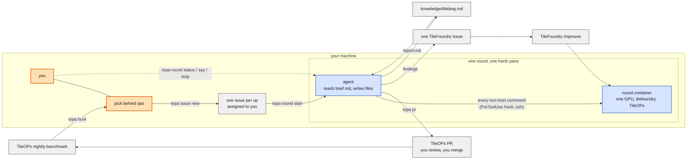

# TOPA

**T**ileFoundry and Tile**O**ps: a **P**ath to **A**utonomous kernel engineering.

Agents build TileOps kernels with TileFoundry. Every kernel improves TileFoundry, and every TileFoundry improvement speeds up the next kernel.

## How a round works

One round is one agent working one [TileOPs](https://github.com/tile-ai/TileOPs) issue:

1. `topa hunt` grades the newest nightly benchmark the way the benchmark site does and
   lists the ops that are behind, with the issue that names each one.
2. `topa issue new <Op>` files one perf issue per op, assigned to you.
3. `topa round start <issue>` creates a TileOPs worktree and branch, a TileFoundry
   checkout, a container with one GPU, and a round directory with the brief. Then it
   starts Claude Code in a herdr pane and tells it to read the brief.
4. The agent runs on the host. A PreToolUse hook sends each shell command that is not
   `git`, `gh`, `topa` or a file operation into the round's container over SSH.
5. The agent writes HIR, analyzes and measures it with TileFoundry, writes the TileLang
   kernel, and runs `topa pr`. That command checks the evidence and opens the PR from
   your fork. TileFoundry problems it hits go into one TileFoundry issue.
6. `topa round stop <slug> [--rm]` stops the agent, archives its transcripts, and with
   `--rm` releases the container, the worktree and the checkout.



A merged PR moves the nightly, and the next hunt sees it. A TileFoundry issue becomes a
TileFoundry fix, and the next round gets it. A person promotes the TileLang facts in a
round report into the knowledge file, and the next agent reads them.

## Install

```bash
git clone https://github.com/tile-ai/topa ~/topa
cd ~/topa
uv venv --python 3.12 .venv
uv pip install --python .venv/bin/python -e .
.venv/bin/topa setup        # writes ~/.topa/config.toml, builds the agent image
```

Edit `~/.topa/config.toml` (paths of the TileOPs and TileFoundry checkouts, Docker
host, GPU), then run `topa setup` again. `topa config` prints the settings in effect.
`TOPA_<NAME>` in the environment overrides one setting for one command.

It needs `claude`, `docker` with the NVIDIA runtime, `gh` (logged in), `git`, `herdr`,
`ssh`, `nvidia-smi` and `uv`.

## Commands

| Command | Does |
| --- | --- |
| `topa setup` | check tools, build `topa:agent`, include the round SSH entries |
| `topa grade` | grade every op of the newest nightly |
| `topa hunt` | the behind ops, their issues, assignees and rounds |
| `topa issue new <Op>...` | file or claim one issue per op |
| `topa round start <issue>` | start a round |
| `topa round say <slug> "..."` | message the round's agent |
| `topa round status` | every round, its agent state and PR |
| `topa round log [<slug>]` | ledger events |
| `topa round stop <slug> [--rm]` | stop, archive, release |
| `topa gate` / `topa pr [--reviewed]` | check the evidence / open the PR (run by the agent) |
| `topa run <cmd>` | one command against a TileOPs worktree in a throwaway container |

State is in `~/.topa/`: `ledger.jsonl` records every event, and `rounds/<slug>/` holds
each round's brief, evidence and archived session.

The Claude Code skills `topa-hunt` and `topa-round` in `.claude/skills/` drive these
commands when you work in this repository.

## Layout

- `src/topa/kit/round/brief.md` is the round contract. `round start` fills its
  placeholders, and an unfilled one is an error.
- `src/topa/knowledge/tilelang.md` holds TileLang and ptxas facts that earlier rounds
  confirmed. Rounds read it. People add to it from round reports.
- `src/topa/kit/container/` holds the agent image: the TileOPs runner image plus sshd.
- `src/topa/gate.py` is the evidence gate that runs before a PR.
- `src/topa/grade.py` follows `scripts/gen_bench_pages.py` in tile-ai/TileOPs.github.io.
  Change both together.
