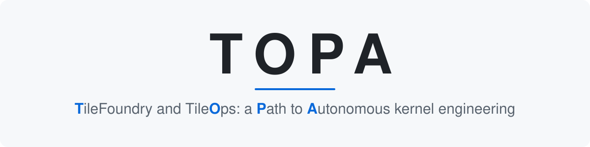

<p align="center">
  
</p>

<p align="center">
  <a href="LICENSE"></a>
  
</p>

Agents build [TileOPs](https://github.com/tile-ai/TileOPs) kernels with
[TileFoundry](https://github.com/tile-ai/TileFoundry). Every kernel improves TileFoundry,
and every TileFoundry improvement speeds up the next kernel.

## Quick start

```bash
git clone https://github.com/tile-ai/topa ~/topa && cd ~/topa
uv venv --python 3.12 .venv && uv pip install --python .venv/bin/python -e .
export PATH="$HOME/topa/.venv/bin:$PATH"
mkdir -p ~/.topa && topa config --default > ~/.topa/config.toml   # then set the repo paths
topa setup
herdr server &             # agents run in herdr panes

topa hunt                  # the newest nightly's queue of ops behind, from the TileOPs wiki
topa round start <Op>      # one agent, one GPU, one op
topa round start --issue <N>   # or one TileOPs issue: bug, feature, docs or perf
topa round status          # every round, its agent and its PR
topa review prepare <PR>   # review a TileOPs PR once, driven by the topa-review skill
```

[Getting started](docs/usage.md) covers the prerequisites and each step.

## Docs

- [Getting started](docs/usage.md): from a new machine to a first round
- [How a round works](docs/workflow.md): the loop, from the nightly's queue to a PR
- [Commands](docs/commands.md): every `topa` command
- [Layout](docs/layout.md): the repository, and what topa keeps on the machine
